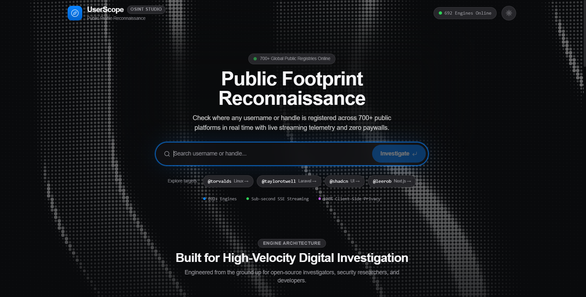
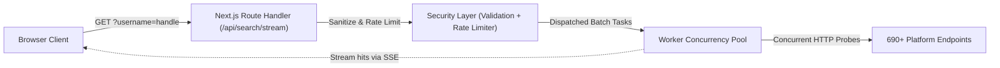

# UserScope

High-speed OSINT username reconnaissance suite and digital footprint discovery tool built with Next.js, real-time Server-Sent Events (SSE), and interactive WebGL visualization.

[](https://nextjs.org/) [](https://www.typescriptlang.org/) [](https://tailwindcss.com/) [](LICENSE)



```bash
# Query footprints across 690+ targets via SSE stream
curl -N "http://localhost:3000/api/search/stream?username=torvalds"
```

---

## Why UserScope?

Most username OSINT tools (Sherlock, WhatsMyName CLI, Blackbird) either:
- **Run solely in terminal shells**, making visual analysis, timeline correlation, and entity filtering tedious.
- **Buffer scans synchronously**, forcing you to wait minutes before seeing a single hit.
- **Rely on external third-party cloud APIs**, leaking the target handle to remote telemetry servers.

UserScope executes checks directly from your local instance via bounded worker pools, streaming live hits over Server-Sent Events the millisecond they are detected.

---

## Core Capabilities

- **Streaming Reconnaissance**: Scans 690+ target platforms concurrently with immediate SSE event dispatching.
- **Defensive Safeguards**: Built-in sliding-window IP rate limiting, active scan concurrency gates, and regex-level SSRF / shell-injection rejection.
- **Multiple Analysis Views**:
  - **Masonry Grid**: Real-time platform cards grouped by service category (developer, social, gaming, finance).
  - **Relationship Graph**: Interactive force-directed canvas displaying shared identity clusters and metadata links.
  - **Presence Timeline**: Historical profile creation and account presence ordering.
- **Data Portability**: One-click full forensic report exports to JSON and formatted CSV.
- **Fluid & Accessible Interface**: Dark and light mode powered by the native View Transitions API, OGL WebGL silk particle wave background, Lenis inertial scrolling, and strict WCAG 2.3.3 reduced-motion gating.

---

## Architecture Flow



---

## Quickstart

### Prerequisites
- Node.js 18.17+ or 20+
- npm, pnpm, or yarn

### 1. Clone & Install

```bash
git clone https://github.com/saahiyo/userscope.git
cd userscope
npm install
```

### 2. Run the Development Server

```bash
npm run dev
```

Open [http://localhost:3000](http://localhost:3000) to start scanning handles.

### 3. Production Build

```bash
npm run build
npm run start
```

---

## API Reference

### Stream Search

`GET /api/search/stream`

Streams live OSINT discovery events using the standard `text/event-stream` protocol.

#### Query Parameters

| Parameter | Type | Required | Description |
| :--- | :--- | :--- | :--- |
| `username` | `string` | Yes | Target handle (3-30 chars, alphanumeric with `.` `_` `-`). |

#### SSE Event Payloads

```typescript
// Incoming profile hit event
{
  "type": "profile_found",
  "data": {
    "siteName": "GitHub",
    "category": "developer",
    "url": "https://github.com/torvalds",
    "exists": true,
    "responseTimeMs": 182,
    "metadata": {
      "bio": "Linus Torvalds",
      "avatar": "https://avatars.githubusercontent.com/u/1024025"
    }
  }
}
```

---

## Security & Ethics

UserScope queries publicly accessible endpoints and does not bypass authentication or break access control boundaries.
- **Rate Limiting**: Default ceiling of 10 requests/minute per client IP with a cap of 2 concurrent scans.
- **Input Sanitization**: Rejects reserved protocol tokens, internal localhost pointers, and special characters before network execution.

Use responsibly in accordance with local regulations and terms of service of queried platforms.

---

## License

MIT
